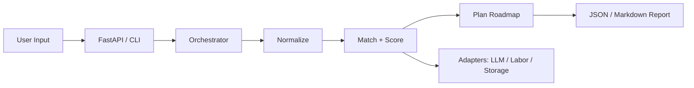

# Skilldispatch

**Translate legacy technical skills into actionable, high-demand AI-adjacent career paths.**

Skilldispatch is an overnight MVP by **AI Frontiers Lab**. It treats workforce transition as an engineering problem: normalize messy skill input, rank AI-adjacent roles, and emit a phased reskilling roadmap through a stable FastAPI contract.

> The static dictionaries are a scaffold. The product is the translation layer between human experience and machine-era roles.

---

## Table of contents

1. [Why Skilldispatch](#why-skilldispatch)
2. [Quick start](#quick-start)
3. [Architecture](#architecture)
4. [Repository layout](#repository-layout)
5. [API reference](#api-reference)
6. [CLI](#cli)
7. [Configuration](#configuration)
8. [Ontology & data plane](#ontology--data-plane)
9. [Extending the system](#extending-the-system)
10. [Testing](#testing)
11. [Documentation map](#documentation-map)
12. [Roadmap](#roadmap)

---

## Why Skilldispatch

Most “pivot to AI” content is generic. Skilldispatch is opinionated about structure:

| Problem | Skilldispatch approach |
| --- | --- |
| Vague advice | Deterministic role ranking + phased actions |
| Messy skill labels | Alias expansion + canonical ontology |
| One-size roadmaps | Experience-aware week estimates and confidence bands |
| Future LLM/labor APIs | Adapter seams that keep `POST /pivot` stable |

Primary workflow:

1. Accept comma-separated legacy skills + years of experience  
2. Normalize tokens and resolve aliases  
3. Score adjacency, demand, and experience fit  
4. Compose foundation → practice → network → specialization → portfolio steps  
5. Return JSON suitable for demos, operators, and future UI clients  

---

## Quick start

```bash
pip install -r requirements.txt
uvicorn main:app --reload
```

Pivot example:

```bash
curl -s http://127.0.0.1:8000/pivot \
  -H 'content-type: application/json' \
  -d '{"skills":"data entry, customer support, excel","experience_years":4}'
```

CLI demo:

```bash
python scripts/run_demo.py
# or
python -m skilldispatch.cli demo
```

---

## Architecture

Skilldispatch is split into layered packages so overnight demo code can grow into production adapters without rewriting callers.

```text
┌────────────────────────────────────────────────────────────┐
│ HTTP (FastAPI) / CLI                                       │
│  middleware: request-id, timing                            │
└───────────────────────────────┬────────────────────────────┘
                                │
┌───────────────────────────────▼────────────────────────────┐
│ services/                                                  │
│  Orchestrator · Validator · Telemetry · Health · Reports   │
└───────────────────────────────┬────────────────────────────┘
                                │
┌───────────────────────────────▼────────────────────────────┐
│ pipelines/                                                 │
│  NormalizeStage → MatchStage → PlanStage → PivotPipeline   │
└───────────────────────────────┬────────────────────────────┘
                                │
┌───────────────────────────────▼────────────────────────────┐
│ domain/                                                    │
│  Normalizer · Matcher · Scoring · Roadmap · Gaps · Rank    │
└───────────────┬─────────────────────────────┬──────────────┘
                │                             │
┌───────────────▼──────────────┐ ┌────────────▼──────────────┐
│ repositories/ + data/        │ │ adapters/                 │
│ skill/role/learning catalogs │ │ LLM · Labor · Storage     │
└──────────────────────────────┘ └───────────────────────────┘
```


<details>
<summary>Mermaid source</summary>



</details>

### Request path

1. **API/CLI** accepts `skills` + `experience_years`
2. **PivotValidator** rejects empty/unusable input
3. **PivotPipeline** runs normalize → match → plan
4. **TelemetrySink / EventBus** record operator events
5. Response includes roles, roadmap, diagnostics, and match metadata

### Design constraints

- Deterministic by default (same input → same ranked shape)
- Offline-first (no credentials required for MVP)
- Soft-fail adapters (stubs never block the core pivot path)
- Backward-compatible `main.py` helpers for tests/demos

---

## Repository layout

```text
app/
├── main.py                 # thin entrypoint + compatibility exports
├── requirements.txt
├── pyproject.toml
├── BRAND.md
├── README.md
├── configs/
│   ├── default.yaml        # human-readable defaults
│   └── scoring.yaml        # ranking weight documentation
├── examples/
│   ├── sample_requests.json
│   └── sample_response.json
├── scripts/
│   ├── run_demo.py
│   ├── dump_ontology.py
│   └── validate_catalog.py
├── docs/
│   ├── ARCHITECTURE.md
│   ├── API.md
│   ├── ONTOLOGY.md
│   ├── CONTRIBUTING.md
│   ├── DEPLOYMENT.md
│   ├── ROADMAP.md
│   ├── adr/                # architecture decision records
│   ├── architecture.png
│   └── architecture.mmd
├── tests/
│   ├── conftest.py
│   ├── fixtures/
│   ├── test_main.py
│   ├── test_pipeline.py
│   ├── test_adapters.py
│   └── test_repositories.py
└── skilldispatch/
    ├── api/                # FastAPI factory + routes
    ├── adapters/           # LLM / labor / storage ports
    ├── cli/                # demo / pivot / ontology commands
    ├── config/             # typed settings
    ├── core/               # constants, exceptions, events, types
    ├── data/               # static ontology + catalogs
    ├── domain/             # pure business logic
    ├── middleware/         # request-id + timing
    ├── models/             # Pydantic contracts
    ├── pipelines/          # staged execution
    ├── repositories/       # read models over data/
    ├── services/           # application services
    └── utils/              # text, diagnostics, hashing, JSON
```

---

## API reference

| Method | Path | Purpose |
| --- | --- | --- |
| `GET` | `/health` | App + adapter health |
| `POST` | `/pivot` | Main translation endpoint |
| `GET` | `/roles?limit=25` | Ranked role catalog slice |
| `GET` | `/roles/{role_title}/market` | Stub market observation |
| `GET` | `/ontology/stats` | Ontology coverage counters |

### `POST /pivot` body

```json
{
  "skills": "data entry, customer support",
  "experience_years": 3
}
```

### Useful response fields

- `target_roles` — ranked AI-adjacent titles  
- `roadmap` — phased actions with priority/hours  
- `role_matches` — adjacency/demand/confidence detail  
- `diagnostics` — operator-facing pipeline counters  
- `pipeline_version` — currently `static-v3`  

Full HTTP notes: [`docs/API.md`](docs/API.md)

---

## CLI

```bash
python -m skilldispatch.cli demo
python -m skilldispatch.cli pivot --skills "excel, sql, recruiting" --years 5
python -m skilldispatch.cli dump-ontology
```

Equivalent scripts:

```bash
python scripts/run_demo.py
python scripts/dump_ontology.py
python scripts/validate_catalog.py
```

---

## Configuration

Typed runtime settings: `skilldispatch/config/settings.py`

Documented mirrors:

- `configs/default.yaml` — feature flags, pipeline limits, adapter modes  
- `configs/scoring.yaml` — demand/adjacency/experience weights + confidence bands  

Key settings:

| Setting | Meaning |
| --- | --- |
| `max_target_roles` | Cap on ranked roles returned |
| `max_roadmap_steps` | Cap on roadmap length |
| `demand_weight` / `adjacency_weight` / `experience_weight` | Composite score blend |
| `llm_mode` / `labor_market_mode` | Adapter posture for ops/health |

---

## Ontology & data plane

Static knowledge bases live under `skilldispatch/data/`:

| File | Contents |
| --- | --- |
| `legacy_skill_map.py` | Canonical legacy skill → role map + aliases |
| `role_catalog.py` | Role metadata + demand scores |
| `learning_paths.py` | Foundation/practice/network/specialization/portfolio actions |
| `market_signals.py` | Synthetic market/obsolescence hints |

Repositories (`skilldispatch/repositories/`) provide read APIs over those files so domain/services never scrape raw dicts directly in new code.

Ontology extension guide: [`docs/ONTOLOGY.md`](docs/ONTOLOGY.md)

---

## Extending the system

### Swap in a real LLM

Implement against `skilldispatch.adapters.llm_adapter.LLMAdapter` / `LocalLLMTranslator` seam. Keep returning structured narrative text; do not change `POST /pivot` field names.

### Swap in live labor data

Replace `LaborMarketClient` usage behind `LaborMarketAdapter.observe()`. Preserve `demand_score` + signal semantics expected by ranking/diagnostics.

### Add resume parsing

Introduce a parser adapter and feed normalized skill text into the existing `NormalizeStage`. The pivot contract can remain skill-string based during migration.

### Persist pivot snapshots

Use `InMemoryStorageAdapter` as the contract reference, then add a DB/file-backed storage adapter.

---

## Testing

```bash
pytest -q
```

Coverage includes:

- API contract + validation (`tests/test_main.py`)
- Domain/pipeline behavior (`tests/test_pipeline.py`)
- Adapter health/translate/observe (`tests/test_adapters.py`)
- Repository coverage/ranking (`tests/test_repositories.py`)

---

## Documentation map

| Doc | Description |
| --- | --- |
| [`docs/ARCHITECTURE.md`](docs/ARCHITECTURE.md) | Layer responsibilities and runtime topology |
| [`docs/API.md`](docs/API.md) | Endpoint contracts and errors |
| [`docs/ONTOLOGY.md`](docs/ONTOLOGY.md) | How to extend skill/role coverage |
| [`docs/CONTRIBUTING.md`](docs/CONTRIBUTING.md) | Local workflow and conventions |
| [`docs/DEPLOYMENT.md`](docs/DEPLOYMENT.md) | Run/deploy and production swap plan |
| [`docs/ROADMAP.md`](docs/ROADMAP.md) | Near/mid/long product plan |
| [`docs/adr/`](docs/adr/) | Architecture decision records |
| [`BRAND.md`](BRAND.md) | Product naming / positioning |

---

## Roadmap

**Now:** deterministic offline MVP with rich package architecture  
**Next:** resume parsing, local LLM narratives, live labor feeds  
**Later:** skills-graph UX, cohort APIs, pivot-quality eval harness  

See [`docs/ROADMAP.md`](docs/ROADMAP.md) for detail.

---

## License / attribution

Built by AI Frontiers Lab as a learning artifact and prototype for human-capital infrastructure.
